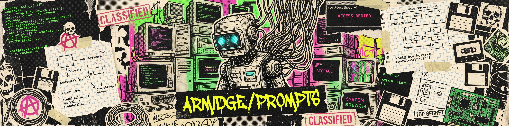

# Prompts

Coleção estruturada de prompts criados para LLMs com execução nativa de código, voltados a profissionais e pesquisadores de segurança da informação e análise de dados. As instruções orientam a IA a processar grandes volumes de dados, analisar logs e capturas de rede, gerar scripts de automação e extrair métricas e indicadores de comprometimento de forma rápida, verificável e reproduzível.

